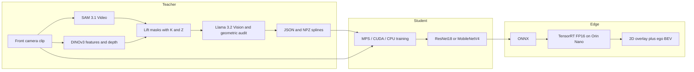

# MGAH Lane Line Auto-Distillation

Monocular 3D lane perception without a roof LiDAR. A teacher built from Meta
foundation models labels its own training set. A small student then predicts
vectorized 3D lane splines from one front-camera frame, and that student
exports to TensorRT FP16 on a Jetson Orin Nano.

Hackathon target: **Meta AI Worldwide Developer Hackathon, 4 November 2026.**
Sprint checklist: [`ROADMAP.md`](ROADMAP.md). Agent contract: [`.cursorrules`](.cursorrules).

## What the pipeline does

1. **Teacher.** SAM 3.1 Video tracks lane markings, road edges, and obstacles
   across a clip. DINOv3 supplies dense features and, once a depth head is
   calibrated, a metric depth map. A ground-plane prior fills in when those
   weights are not on disk. Each mask is unprojected to camera-frame XYZ and
   resampled to 10 knots. Llama 3.2 Vision is the semantic auditor; offline,
   a geometric checker grades the same splines.
2. **Student.** A ResNet18 or MobileNetV4 network reads one RGB frame and
   regresses up to four 3D splines. Training prefers Apple Silicon MPS, then
   CUDA, then CPU.
3. **Edge.** The student exports to ONNX and a TensorRT FP16 engine. A
   headless visualizer draws the 2D overlay and a bird's-eye grid.

No Meta or Hugging Face call is made unless you opt in. Request payloads are
built either way, so the live path has a place to land.



```text
clip ──► SAM 3.1 masks ──┐
                         ├─► unproject ─► K=10 knots ─► audit ─► labels
        DINOv3 Z(u,v) ───┘                                  │
                                                            ▼
                         frame ──► student [B,4,31] ──► ONNX ──► Orin FP16
```

## Frames and spline layout

Defined in `src/common/geometry.py`.

| Frame | Axes | Origin |
| --- | --- | --- |
| Camera optical | +X right, +Y down, +Z forward | Camera center |
| Ego / vehicle | +X right, +Y forward, +Z up | Ground under the camera |

Positive pitch looks down. Depth `Z` unprojects as:

```text
X = (u - cx) * Z / fx
Y = (v - cy) * Z / fy
```

The student stores knots in the **camera** frame.

| Slot | Role |
| --- | --- |
| 0 | ego_left |
| 1 | ego_right |
| 2 | left_adjacent |
| 3 | right_adjacent |

Each slot is 31 numbers: one existence value, then 10 knots of `(X, Y, Z)`.
The batch tensor is `[B, 4, 31]`. Channel 0 is an existence **logit** on the
prediction and `{0, 1}` on the target. Knot loss ignores lanes that are absent.

Model input for ONNX and TensorRT is RGB float `NCHW` in `[0, 1]`. ImageNet
normalization sits inside the network.

## Repository layout

```text
├── .cursorrules                 # agent contract
├── AGENTS.md
├── README.md
├── ROADMAP.md
├── requirements.txt
├── pyproject.toml
├── .env.example
├── configs/
│   ├── teacher_config.yaml
│   ├── student_config.yaml
│   └── jetson_config.yaml
├── data/
│   ├── raw/                     # clips (generated or nuScenes)
│   └── processed/               # distilled JSON + NPZ
├── src/
│   ├── common/                  # geometry, schemas, device
│   ├── teacher/                 # SAM, DINOv3, lifter, auditor
│   ├── student/                 # dataset, model, loss, MPS loop
│   ├── export/                  # ONNX
│   └── edge/                    # TensorRT harness + dual-view
├── scripts/
│   ├── download_sample_data.py
│   ├── run_distillation.py
│   └── run_eval_visualization.py
└── tests/
```

## Quickstart

```bash
python3 -m venv .venv
source .venv/bin/activate
pip install -r requirements.txt
cp .env.example .env

pytest

python scripts/download_sample_data.py
python scripts/run_distillation.py \
  --input data/raw/synthetic_clip \
  --output data/processed/synthetic_clip

python -m src.student.train \
  --data data/processed/synthetic_clip \
  --epochs 2 --batch-size 2 --num-workers 0

python -m src.export.export_onnx \
  --checkpoint artifacts/student.pt \
  --output artifacts/student.onnx

python scripts/run_eval_visualization.py \
  --labels data/processed/synthetic_clip \
  --output artifacts/viz
```

A one-step synthetic train that does not need distilled labels:

```bash
python -m src.student.train --synthetic --epochs 1 --max-steps 2 --backbone tiny
```

On a CPU-only Linux box, install the CPU PyTorch wheels before `requirements.txt`
or pip may pull a large CUDA wheel. The command is at the top of
[`requirements.txt`](requirements.txt).

### Live teacher models

Keep `META_API_MOCK=1` until you intend to spend API credits.

```bash
# .env
META_API_MOCK=0
META_AI_API_KEY=...
HUGGINGFACE_TOKEN=...
```

Then construct `DINOv3DepthEstimator(..., local_files_only=False)` once to fill
the Hugging Face cache. Metric depth uses `PatchDepthHead` only after a
checkpoint is passed as `depth_head_path`. Until then the lifter uses the
ground-plane prior and DINOv3 tokens stay available for feature distillation.

### nuScenes mini

The sample script does not download nuScenes (the archive is gated). After you
unpack it:

```bash
python scripts/download_sample_data.py --nuscenes-root /path/to/nuscenes --scene-index 0
```

That writes an intrinsics sidecar next to exported camera frames. Distillation
then uses the same command as the synthetic clip.

### Jetson Orin Nano

```bash
trtexec --onnx=artifacts/student.onnx \
  --saveEngine=artifacts/student_fp16.engine --fp16
python -m src.edge.trt_runner \
  --engine artifacts/student_fp16.engine \
  --onnx artifacts/student.onnx
```

Machines without TensorRT run the same harness on ONNX Runtime.

## What is real in this scaffold

| Piece | Status |
| --- | --- |
| Unprojection, ego extrinsics, K=10 resampling | Implemented and tested |
| Mask centerline → 3D knots | Implemented and tested |
| Geometric auditor in `[0, 1]` | Implemented and tested |
| SAM 3.1 and Llama 3.2 HTTP calls | Payloads built; mocked unless `META_API_MOCK=0` |
| DINOv3 | Loader is local-only; depth falls back to the ground plane or a cached map |
| Student, masked loss, checkpoint loop | Runs on MPS, CUDA, or CPU |
| ONNX export | Tested via ONNX Runtime |
| TensorRT FP16 | Harness and `trtexec` command; engine build is on the Orin |
| Dual-view visualizer | Headless OpenCV (overlay + ego BEV) |

## Label schema

`data/processed/<clip>/frame_000000.json` validates as `Frame3DAnnotation`:

- `frame_idx`, `timestamp_us`, `lanes`, `camera_k` (3×3), `audit_score`
- each lane: `lane_id`, `lane_type`, `confidence`, `knots[{x,y,z}]`, `role`
- optional mount: `camera_height_m`, `pitch_rad`, `image`, `audit_issues`

The matching `.npz` stores fixed `[4, 10, 3]` knots and an existence mask so
NumPy training code can skip pydantic. Knots are meters in the camera frame.

Lane types the auditor knows: `dashed`, `solid`, `double_yellow`, `road_edge`,
`unknown`. The offline color heuristic maps yellow markings to `double_yellow`
and leaves the VLM prompt to split double lines from single yellow when the
API is on.
